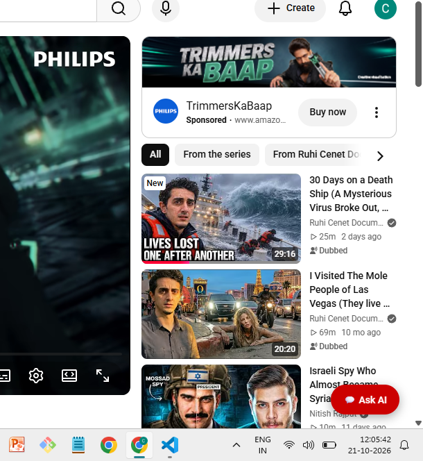
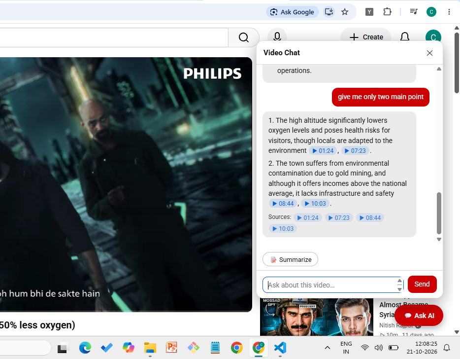
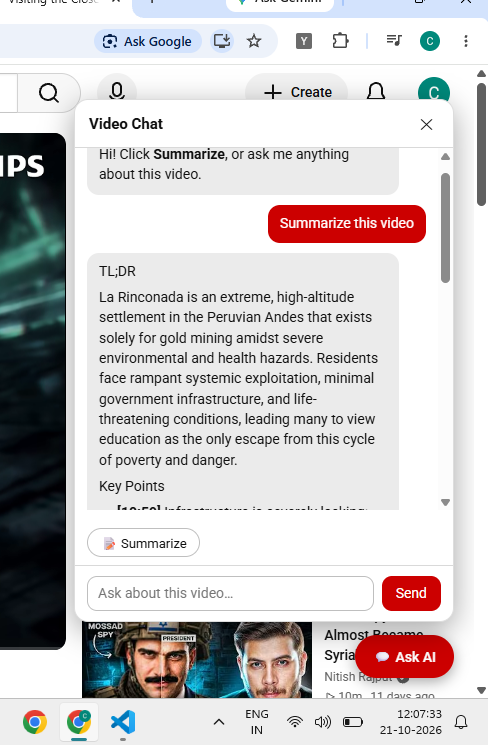

# YouTube Video Chat — AI-Powered RAG Chrome Extension

Ask questions about YouTube videos, generate summaries, and jump directly to relevant timestamps using AI.

A Chrome Extension powered by Retrieval-Augmented Generation (RAG), built with JavaScript, FastAPI, LangChain, OpenAI, and FAISS.

## Features

- **AI-Powered Q&A:** Ask questions about a video's transcript.
- **Timestamped Answers:** Navigate to relevant moments in a video.
- **Video Summarization:** Generate summaries of long videos using map-reduce.
- **Semantic Search:** Retrieve relevant transcript chunks using vector embeddings.
- **Source-Grounded Responses:** Generate answers using retrieved transcript context and indicate when the information is not covered.
- **Modular Backend:** Separate components for chunking, retrieval, generation, summarization, and storage.
- **Automated Tests:** Backend test suite using pytest.

## Tech Stack

| Component | Technology |
|---|---|
| Browser Extension | JavaScript, Chrome Manifest V3 |
| Backend API | Python, FastAPI |
| LLM Orchestration | LangChain, LCEL |
| Language Model | OpenAI GPT-4o mini |
| Embeddings | OpenAI text-embedding-3-small |
| Vector Store | FAISS |
| Testing | pytest |

## Architecture

1. The extension reads the video's available transcript.
2. The transcript is split into overlapping chunks with timestamps.
3. OpenAI embeddings are generated and stored in a per-video FAISS index.
4. For questions, relevant chunks are retrieved using semantic similarity.
5. LangChain passes the retrieved context to the language model to generate a grounded answer.
6. The extension displays the response with clickable timestamps.

Long videos are summarized using a map-reduce approach.

## Project Structure

```text
youtube-rag-extension/
├── backend/
│   ├── src/rag_chatbot/
│   │   ├── api.py
│   │   ├── chunking.py
│   │   ├── config.py
│   │   ├── generator.py
│   │   ├── llm.py
│   │   ├── models.py
│   │   ├── retriever.py
│   │   ├── store.py
│   │   ├── summarizer.py
│   │   └── transcript.py
│   ├── tests/
│   ├── requirements.txt
│   └── .env.example
├── extension/
│   ├── manifest.json
│   ├── content.js
│   └── background.js
├── .gitignore
├── LICENSE
└── README.md
```

## Getting Started

### Prerequisites

- Python 3.10 or another version supported by your dependencies
- Google Chrome
- An OpenAI API key

### 1. Clone the repository

```bash
git clone https://github.com/YOUR_USERNAME/youtube-rag-extension.git
cd youtube-rag-extension
```

### 2. Configure the backend

```bash
cd backend
python -m venv .venv
```

Activate the virtual environment on Windows:

```powershell
    .venv\Scripts\activate
    or
    .venv\Scripts\Activate.ps1
```

Install dependencies:

```bash
pip install -r requirements.txt
```

Copy the example environment file:

```powershell
Copy-Item .env.example .env
```

Add your OpenAI API key to `backend/.env`.

### 3. Start the backend

```bash
uvicorn rag_chatbot.api:app --app-dir src --reload
```

Verify the API at `http://localhost:8000/health`.

### 4. Install the Chrome extension

1. Open `chrome://extensions`.
2. Enable Developer mode.
3. Click **Load unpacked**.
4. Select the project's `extension/` directory.
5. Open a supported YouTube video and click **Ask AI**.

Configure the extension's backend URL according to the project's configuration before use.

## Running Tests

From the `backend/` directory:

```bash
pytest
```


### 2. Extension
1. Open `chrome://extensions`
2. Turn on **Developer mode** (top right)
3. Click **Load unpacked** and choose the `extension/` folder
4. Open any YouTube video **with captions** and click **Ask AI** (bottom right)

After editing extension files, click the reload icon on the extension card and refresh the YouTube tab.

### 3. Tests
```bash
cd backend
pytest
```

## Deploying
1. Deploy `backend/` to Render, Railway, or similar (start command: `uvicorn rag_chatbot.api:app --app-dir src --host 0.0.0.0 --port $PORT`).
2. Set `OPENAI_API_KEY` and `EXTENSION_TOKEN` (any long random string) as environment variables there.
3. In `extension/background.js` set `BACKEND_URL` and `API_TOKEN`, and add your backend URL to `host_permissions` in `manifest.json`.

## Troubleshooting
- **"YouTube is blocking this server's IP address" (IpBlocked):** YouTube refuses caption requests from some IPs (VPNs, cloud servers, or an IP that made many requests). The extension first tries to read the transcript **inside your browser**, so this message means that failed too. Things to try: turn on captions (**CC**) in the player and ask again; open the transcript under the video (description > *Show transcript*) and ask again; turn off any VPN or switch network. Optionally set `TRANSCRIPT_PROXY_URL` in `backend/.env` so the server-side fallback uses a proxy.
- **See which method read the transcript:** open DevTools (F12) > Console on the YouTube tab and look for lines starting with `[YouTube RAG]`. The extension tries three methods in order: caption tracks, the player's own caption request, and the "Show transcript" panel.
- **Button not visible:** it only appears on normal `youtube.com/watch?v=...` pages. Click the extension icon, or refresh the tab.

## Known limitations
- Videos without captions are not supported yet (idea: fall back to Whisper speech-to-text).
- Indexed videos are kept in memory (last 20) and are lost when the server restarts. The extension re-sends the transcript automatically.
- YouTube changes its page often. The in-browser methods (especially reading the transcript panel) may need small updates when it does.

## Ideas to extend
Whisper fallback, per-video chat memory, streaming answers, multilingual summaries, saving past summaries.
#--------------------------------------------------------------------------------------------
#Images

## Screenshots

### YouTube Video Chat Interface


### AI Chat with Timestamped Answers


### AI-Generated Video Summary

